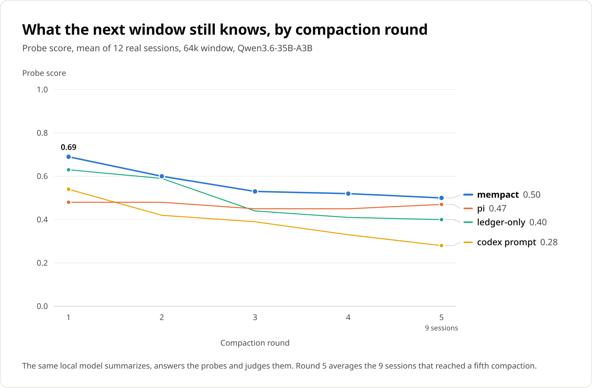

<p align="center">
  
</p>

# mempact

mempact replaces the compaction step in a coding agent. When the context
window fills, it decides what the next window keeps. It ships as an
extension for the [pi coding agent](https://github.com/badlogic/pi-mono)
and as a TypeScript core with no runtime dependencies that any harness
can call.

The idea is to let code record the facts and let the model write only the
story. Code builds a ledger from the full session: the files touched, the
commands run with their exit codes, the rules the user stated, and the
identifiers that came up. The model writes a short narrative under fixed
headings: the goal, the decisions and why, what was learned, what failed,
and the next step. The ledger cannot decay because code rebuilds it from
the original messages every time. The narrative is checked by code, and
anything the model drops from one round to the next is carried forward.

## Results

On twelve real coding sessions, mempact kept more of what the next window
needed than pi's own compaction, in every session.

<p align="center">
  
</p>

The benchmark replays each session through four compaction rules at the
same message boundaries. At each boundary the model reads the messages
about to be dropped and writes questions a resuming agent would need
answered. Every rule then answers every question so far from its own
compacted context, and the model grades each answer. The score is the
share of answers judged right. Questions from earlier rounds stay in the
pool, so forgetting across rounds shows up as decay.

<p align="center">
  
</p>

| mempact against | mean gain | 95% interval | sessions won |
|---|---|---|---|
| pi's compaction | +0.10 | 0.08 to 0.14 | 12 of 12 |
| ledger only, no narrative | +0.07 | 0.04 to 0.09 | 12 of 12 |
| codex's prompt, one summary | +0.17 | 0.13 to 0.21 | 12 of 12 |

The sessions are 187k to 437k tokens of real Claude Code transcripts,
replayed with a 64k window and up to five compaction rounds. One local
model, Qwen3.6-35B-A3B, wrote the summaries, answered the questions and
graded the answers for all four rules. The numbers come from
`bench/results/live-qwen3.6-35b-a3b-12s-2026-10-15.csv`.

Two things to know before quoting them. Part of the gap to pi on this
model is prompt wording. Pi's prompt says to keep each section concise,
and this model took that literally, writing about 600 summary tokens in
round 1 against 2,400 for mempact. In the three sessions where both wrote
summaries of similar length, mempact still won, by 0.02 to 0.11. On an
earlier run with Qwen3.8-27B, where pi wrote full summaries, mempact was
0.05 ahead. And twelve sessions with one judge model is still a small
sample. [bench/README.md](bench/README.md) describes the method, its
limits, and how to run it.

## What the model sees after a compaction

<p align="center">
  
</p>

The next request reads in this order.

1. **Project memory.** If `.mempact/memory.md` exists, it is read from
   disk and sent as the first message of every request. Compaction never
   touches it, so the prompt-cache prefix stays stable until the file
   changes.
2. **Recent user messages.** The newest real user messages from before
   the raw tail, verbatim, up to 20k tokens. This is codex's rule.
3. **The summary.** Codex's handoff text, then the narrative, then the
   ledger, then a note that the summary is reference and the latest user
   message wins.
4. **The raw tail.** The most recent messages, verbatim, up to 20k tokens
   or a quarter of the window, whichever is smaller. The cut never splits
   a tool call from its result.
5. **Rehydrated files.** The current text of up to five recently modified
   files, read from disk at compaction. Large or missing files are listed
   by path only.

### The ledger

`core/ledger.ts` builds the ledger from the original messages, never from
an earlier summary. It holds the modified and read files, the commands
with their exit codes and the line that names each error, the user's
rules quoted verbatim and marked superseded when a later message reverses
them, explicit changes of goal, identifiers such as URLs, commit SHAs and
PR numbers, and the latest user request. Each list has a cap, so a long
session drops its oldest entries first.

### The narrative

The summarizer gets the previous narrative and the messages since, never
a previous summary with a ledger inside it, so summaries are never
summarized. It writes under seven headings: Goal, Decisions and why,
Findings, Approaches that failed, Current work, Next step, Open questions.
The prompt asks for how code behaves and why it is written that way, with
exact file names, function names and error messages, because those are
the facts a resuming model would otherwise rediscover.

`core/summarySchema.ts` checks the result. Every heading must be present
and filled, the text must not be cut off by the output limit, and the
Next step must name a modified file or a command when the ledger has any.
On failure it asks once more, then accepts the result with a note listing
what is still missing. An empty reply is retried too.

Then `core/carry.ts` compares the new narrative with the previous one.
Any decision, finding or failed approach the model dropped is appended
back under its heading as "Carried from earlier windows", up to 3,000
tokens, oldest dropped first. Before this step existed, the model lost
earlier findings on every rewrite, and mempact trailed pi on questions
older than one round. After it, mempact led on them.

## Between compactions

- **Output cap.** A tool output over 12,000 bytes is cut in the middle
  when recorded. The full text is saved first under
  `.mempact/artifacts/`, and the cut text names the artifact id.
- **Tool-output clearing.** When the context reaches about 63% of the
  window, every tool output except the newest three is replaced in the
  request by a one-line stub. The session file keeps the originals.
- **Trigger.** Compaction fires at 90% of the window, codex's rule. A
  reminder fires 10k tokens before that and asks the model to save state
  with `update_memory` when a memory file exists.
- **Thrash guard.** If the last two compactions each freed under 10%, the
  automatic trigger pauses. Manual `/compact` and overflow recovery stay
  on.
- **Resume.** If the compaction interrupted a tool loop, a hidden prompt
  resumes the task. This works in interactive and RPC modes.

## Install for pi

```bash
pi install git:github.com/topmass/mempact
# or try it for one session without installing:
pi -e git:github.com/topmass/mempact
```

Then hand compaction to mempact in `~/.pi/agent/settings.json`. mempact
warns until you do.

```json
{ "compaction": { "enabled": false } }
```

That setting also turns off pi's built-in overflow recovery, so if mempact
fails to load there is no compaction at all. With no model, no auth, or a
failed summary call, mempact falls back to pi's compaction.

mempact writes `.mempact/memory.md` and `.mempact/artifacts/` into your
project. Add `.mempact/` to `.gitignore` if you do not want them
committed.

Settings are constants at the top of `pi/index.ts`. The extension
typechecks against pi 0.78, and the peer range allows 0.78 to 0.80.

## Tools and the command

- `recall` searches the full session history, including compacted turns
  and cleared outputs. With an artifact id it reads a saved output by line
  range, or lists the lines that match a query.
- `update_memory` sets a section of `.mempact/memory.md` or appends one
  line to it. The sections are Goal, Plan, Decisions, Files, Next, Open.
- `get_context_remaining` reports the tokens left before compaction.
- `new_context` starts a new window with no summary, codex's hard reset.
- `/mempact` shows the window number, token use against the trigger, the
  memory file state, the count of cleared outputs, and whether the
  trigger is paused.

## Use the core in another harness

`core/` has no runtime dependencies and only type imports from pi-ai.
`compactWindow` runs one compaction. You supply the model call and a
token estimate, then lay out the request from what it returns.

```ts
import { compactWindow, OverflowError } from "./core/index.ts";

const result = await compactWindow(
  { messages, previous, contextWindow, maxOutputTokens, instructions },
  {
    // throw OverflowError when the request does not fit the window
    summarize: (systemPrompt, messages, maxTokens) => Promise<string>,
    estimateTokens: (message) => number,
  },
);
// result: ledger, narrative, retainedUserMessages, rawTail,
//         summaryText, rehydratePaths, validation
```

`previous` is `{ narrative, start }` from the last round. The summary
call gets its own system prompt, so the model summarizes the conversation
instead of continuing it. `clearOldToolOutputs`, the memory helpers in
`core/memory.ts`, and the recall helpers in `core/recall.ts` are exported
for the other layers.

## Why it is built this way

Facts stored in prose decay when each summary is summarized again. Two
papers measure this,
[cascading compaction](https://arxiv.org/abs/2605.24657) and
[Compaction Cliff](https://arxiv.org/abs/2608.22752). Agents break user
rules more often after a compaction, and
[ConstraintRot](https://arxiv.org/abs/2606.22528) shows that keeping the
rules outside the summary fixes it. Codex's compaction quality comes from
[model training](https://openai.com/index/gpt-5-1-codex-max/), which an
open-source harness cannot copy, so mempact competes on what the harness
does around the model.

## Not in mempact

- No post-compaction quiz or self-check by the model.
- No graph memory. The benchmark shows the losses are in what the summary
  captures, not in how the facts are stored.

## Development

```bash
pnpm install
pnpm test        # 97 tests, including byte-exact parity with codex's truncation
pnpm typecheck
pnpm bench --fixture small --window 32000   # offline, fake summarizer
```

## Lineage and license

The base engine is a TypeScript port of
[openai/codex](https://github.com/openai/codex) at tag `rust-v0.142.5`.
The Rust sources it was ported from are vendored under `reference/`, and
[reference/PIN.md](reference/PIN.md) records the commit. The handoff text
and trigger constants are kept verbatim. The ledger, narrative schema,
carry-forward, clearing, artifacts, memory and benchmark are original to
this repo. Apache-2.0 throughout.
