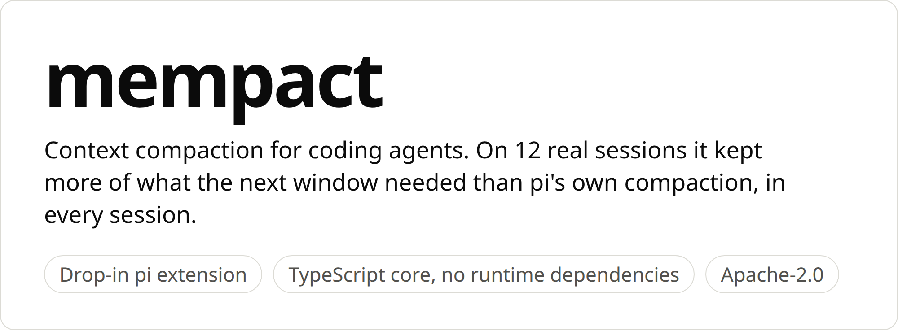
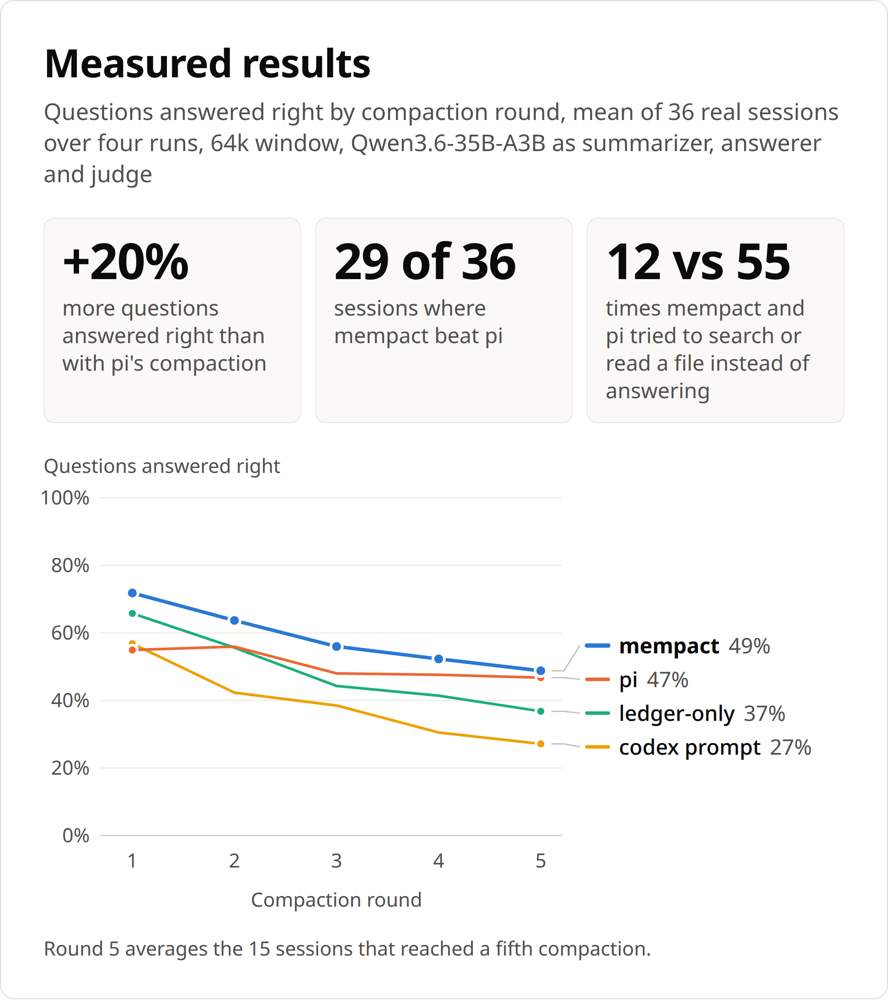
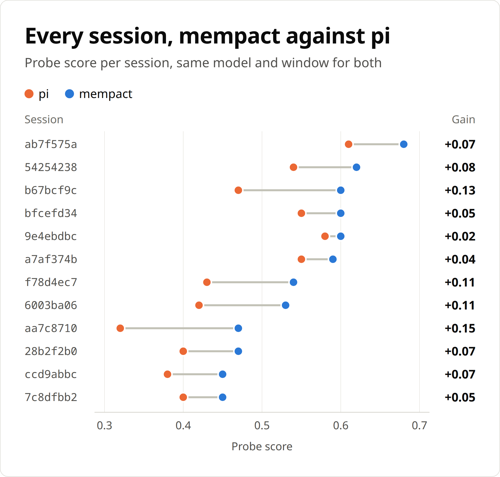
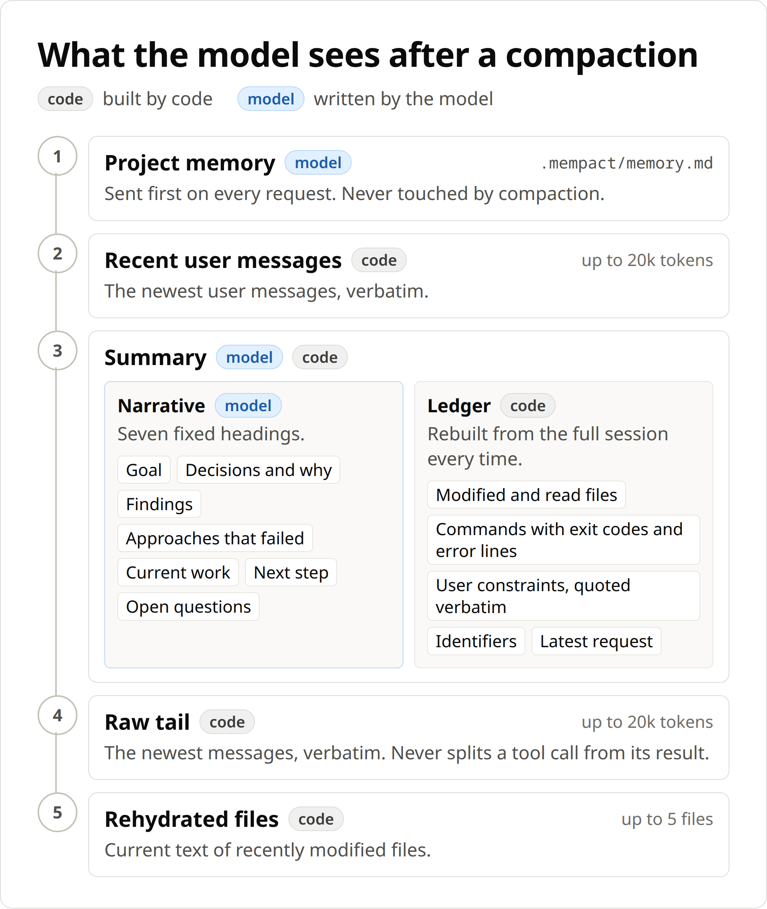

<p align="center">
  
</p>

mempact replaces the compaction step in a coding agent. When the context
window fills, code builds a ledger of the facts from the full session and
the model writes a short narrative around them. The next window gets both,
plus the newest messages verbatim. It ships as an extension for the
[pi coding agent](https://github.com/badlogic/pi-mono) and as a TypeScript
core that any harness can call.

## Results

With mempact's compaction, the model answered about 20% more questions
right than with pi's, over 36 real coding sessions.

<p align="center">
  
</p>

The benchmark replays 36 real Claude Code sessions through four compaction
rules at the same message boundaries with a 64k window. Each session runs
up to five compactions, which covers its first 100k to 230k tokens. At each
boundary the model reads the messages about to be dropped and writes the
questions a resuming agent would need answered. Every rule then answers
every question so far from its own compacted context, and the model grades
the answers. A half-right answer counts as half. Questions stay in the pool
across rounds, so forgetting shows up as decay. One local model,
Qwen3.6-35B-A3B, did all of it for all four rules.

The whole benchmark ran four times, once with greedy summaries and three
times with sampled ones. Pooled over the four runs, pi answered 53% of the
questions right per session, and mempact answered 11 percentage points
more, with a 95% interval of 7 to 15 points. Each single run gave between
9 and 12 points, and mempact beat pi in 29 of the 36 sessions. mempact also
beat the ledger alone by 9 points and the codex prompt by 19.

<p align="center">
  
</p>

Each rule gave 9,736 answers over the four runs. Counted over all of them,
which weights the later and harder rounds more, 40% of mempact's answers
were fully right against 32% of pi's, and 26% were wrong against 31%. The
two rules said "unknown" about as often, 1,186 times for mempact and 1,239
for pi, so mempact's extra right answers came from what its context held.
Pi tried to run a search or read a file instead of answering 55 times, and
mempact did that 12 times. The ledger alone got 33% fully right and 39%
wrong, and the codex prompt got 25% right and 51% wrong, with 4,090
"unknown" answers.

Some caveats apply. Pi's prompt asks for concise sections, and this model
took that literally, so in the first round pi wrote about a quarter as much
summary as mempact. The lead is largest right after the first compaction,
at 17 points, and shrinks to 2 points by the fifth, where both rules answer
just under half the questions right. On each session's final round mempact
led pi by 6 points, with an interval of 3 to 9. One model judged every
answer, and all 36 sessions come from one user. Three sessions also ran at
a 180k window with two to five compactions each, and mempact led pi there
by 11 points on average, from 8 to 15, but three sessions are too few to
count as a result. The method, its limits and how to run it are in
[bench/README.md](bench/README.md). The numbers are in `bench/results/`.

## How it works

<p align="center">
  
</p>

The ledger is built by `core/ledger.ts` from the original messages, never
from an earlier summary, so it cannot decay. It holds the modified and
read files, the commands with their exit codes and error lines, the user's
rules quoted verbatim and marked when a later message reverses them,
identifiers such as URLs and commit SHAs, and the latest request.

The narrative is written by the model under seven fixed headings. The
prompt asks for how code behaves and why, with exact file and function
names, since those are the facts a resuming model would otherwise have to
rediscover. `core/summarySchema.ts` checks every heading is filled and the
next step names a real file or command, and asks once more if not. Then
`core/carry.ts` compares the new narrative with the previous one and
appends back any decision, finding or failed approach the model dropped.

Between compactions, tool outputs over 12,000 bytes are cut in the middle
and saved whole under `.mempact/artifacts/`, old tool outputs are stubbed
out of the request once the context passes 63% of the window, and
compaction fires at 90%. The constants are at the top of `pi/index.ts`.

## Install for pi

```bash
pi install git:github.com/topmass/mempact
# or try it for one session:
pi -e git:github.com/topmass/mempact
```

Then hand compaction to mempact in `~/.pi/agent/settings.json`:

```json
{ "compaction": { "enabled": false } }
```

With no model, no auth, or a failed summary call, mempact falls back to
pi's compaction. It writes `.mempact/` into your project, so add it to
`.gitignore` if you do not want it committed. The extension typechecks
against pi 0.78 and the peer range allows 0.78 to 0.80.

The extension adds four tools and one command. `recall` searches the full
session history, including compacted turns. `update_memory` edits
`.mempact/memory.md`. `get_context_remaining` reports the tokens left
before compaction. `new_context` starts a fresh window with no summary.
`/mempact` shows the window number, token use, and memory state.

## Use the core in another harness

```ts
import { compactWindow, OverflowError } from "./core/index.ts";

const result = await compactWindow(
  { messages, previous, contextWindow, maxOutputTokens, instructions },
  {
    // throw OverflowError when the request does not fit the window
    summarize: (systemPrompt, messages, maxTokens) => Promise<string>,
    estimateTokens: (message) => number,
  },
);
// result: ledger, narrative, retainedUserMessages, rawTail,
//         summaryText, rehydratePaths, validation
```

`core/` has no runtime dependencies. You supply the model call and a token
estimate, and lay out the request from what comes back. `previous` is
`{ narrative, start }` from the last round.

## Background

Facts stored in prose decay when each summary is summarized again, as
[cascading compaction](https://arxiv.org/abs/2605.24657) and
[Compaction Cliff](https://arxiv.org/abs/2608.22752) measure. Agents break
user rules more often after a compaction, and
[ConstraintRot](https://arxiv.org/abs/2606.22528) shows that keeping the
rules outside the summary fixes it. That is why the ledger is code and the
narrative is checked.

The base engine is a TypeScript port of
[openai/codex](https://github.com/openai/codex) at tag `rust-v0.142.5`,
vendored under `reference/`. The ledger, narrative schema, carry-forward,
clearing, artifacts, memory and benchmark are original to this repo.
Apache-2.0.

```bash
pnpm install && pnpm test && pnpm typecheck
```
